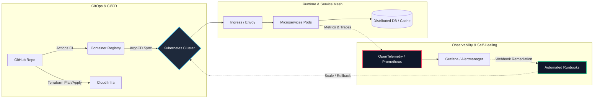

<!-- 100% Reliable Native Header + Animated Typing SVG -->
<div align="center">

  # Hi there, I'm Pradeep Kumar 👋
  ### **Senior Site Reliability Engineer | Cloud Infrastructure & Distributed Systems**

  <!-- Animated Typing SVG (Hosted on reliable demolab.com) -->
  <a href="https://github.com/iampradeepone">
    
  </a>

  <br/>

  <!-- Status & Social Badges -->
  <p>
    <a href="https://linkedin.com/in/YOUR_LINKEDIN_HANDLE" target="_blank">
      
    </a>
    <a href="mailto:YOUR_EMAIL@example.com">
      
    </a>
    <a href="https://github.com/iampradeepone?tab=followers">
      
    </a>
    
  </p>
</div>

---

### 🖥️ `$ kubectl describe engineer pradeep-kumar`

```yaml
apiVersion: engineering.sre/v1
kind: SeniorSiteReliabilityEngineer
metadata:
  name: pradeep-kumar
  handle: "@iampradeepone"
  location: "Bengaluru, India"
spec:
  corePhilosophy: "Treat operations as a software problem. Automate toil, enforce SLOs, design for failure."
  specializations:
    - Multi-Cloud Infrastructure & Kubernetes Platform Engineering
    - Full-Stack Observability, OpenTelemetry & Prometheus/Grafana
    - GitOps Delivery Pipelines, IaC & Automated Incident Remediation
    - High-Scale Enterprise & Mission-Critical Distributed Systems
  currentFocus:
    - eBPF-based Kernel Observability & Network Security
    - AI-Driven Incident Response (AIOps) & Self-Healing Workflows
    - Kubernetes Operator Development in Go & Python
status:
  availability: "Always open to discussing architecture, reliability, and high-scale engineering"
```

---

### 🏗️ Reference Production Architecture



---

### 🛠️ Production Arsenal

<div align="center">

| Domain | Technologies & Ecosystem |
| :--- | :--- |
| **Cloud & OS** |     |
| **Orchestration** |     |
| **IaC & GitOps** |     |
| **Observability** |     |
| **Code & Scripting** |    |

</div>

---

### 📌 Featured Blueprints & Engineering Focus

| Area | Architecture & Implementation Focus | Core Stack |
| :--- | :--- | :--- |
| **Multi-Cluster GitOps** | Automated production-grade Kubernetes cluster provisioning, policy enforcement, and zero-downtime deployment pipelines. | `Terraform` `K8s` `ArgoCD` `Helm` |
| **Unified Observability & SLOs** | End-to-end telemetry pipelines with custom exporters, multi-window burn-rate alerts, and distributed tracing. | `Prometheus` `Grafana` `OpenTelemetry` |
| **Self-Healing Automation** | Event-driven remediation scripts, chaos engineering workflows, and automated runbooks to minimize MTTR. | `Python` `Go` `Ansible` `Linux` |

---

### 📊 Live Telemetry & Engineering Metrics

<div align="center">
  
</div>

<div align="center">
  
</div>

---

<details>
<summary><b>⚡ Click to expand: My Core SRE Operating Principles</b></summary>
<br>

1. **SLOs Over Gut Feelings:** If an alert doesn't threaten an Error Budget or impact customer-facing SLIs, it shouldn't page an engineer at 2 AM.
2. **Eliminate Toil Recursively:** If an operational task has to be performed manually more than twice, it belongs in a Terraform module, Kubernetes controller, or automated runbook.
3. **Blameless Postmortems:** Outages are systemic failures, never human failures. Every incident is an investment in hardening the architecture.
4. **Immutable Infrastructure:** Servers are cattle, not pets. Patching means redeploying from a verified pipeline.

</details>

---

<!-- 100% Reliable Native Footer -->
<div align="center">
  
  
  
  <br/><br/>
  <sub><b>Engineered with reliability by <a href="https://github.com/iampradeepone">@iampradeepone</a></b></sub>
</div>